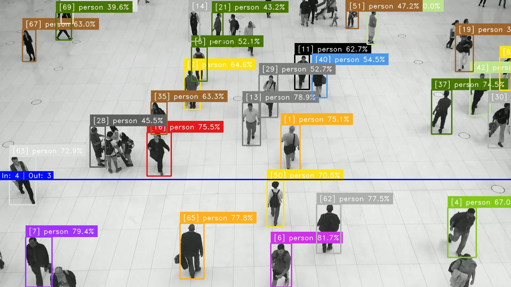
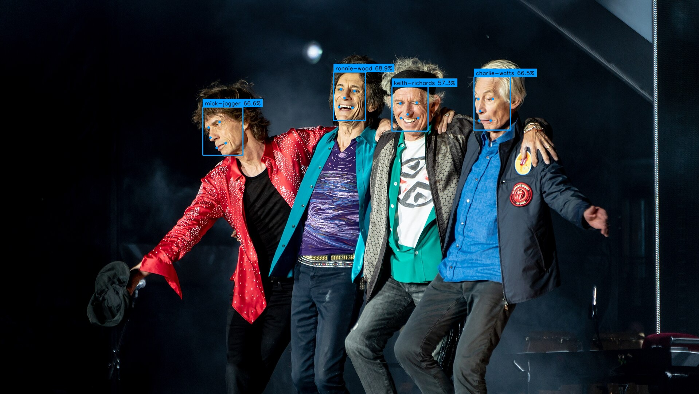

[](https://github.com/abraia/abraia-multiple/actions/workflows/build.yml)
[](https://pypi.org/project/abraia/)

[](LICENSE)

# Abraia Vision SDK

Abraia is a Python SDK and command-line tool for computer vision and image
processing. Use it to run vision models on images and video, combine inference
with tracking and counting, edit images, and manage files in Abraia storage.
Inference runs through ONNX Runtime or a compatible Hailo accelerator.

## Contents

- [Installation](#installation)
- [Quick start](#quick-start)
- [Command-line usage](#command-line-usage)
- [Python API](#python-api)
- [Pipelines](#pipelines)
- [Additional inference models](#additional-inference-models)
- [Hardware acceleration](#hardware-acceleration)
- [License](#license)

## Installation

Install the SDK and its `abraia` command:

```sh
python -m pip install -U abraia
```

Enable shell completion after installing. Abraia detects Bash, Zsh, or Fish
from the `SHELL` environment variable; pass the shell name to override it:

```sh
abraia configure --completion
# or: abraia configure --completion --shell fish
```

For remote file operations, configure your Abraia API key:

```sh
abraia configure
```

The command shows where to obtain your key and saves it for future commands.
You can also set the `ABRAIA_KEY` environment variable. Python applications
use the same credentials or accept a key through `Abraia(abraia_key="...")`.


## Quick start

Run object detection on a local video and save the rendered result:

```sh
abraia run demo detect input.mp4 --output result.avi
```

List connected local cameras, then run detection with the camera index shown:

```sh
abraia discover cameras
abraia run demo detect 0
```

To use an ONVIF camera on the local network, discover its RTSP URL and pass it
as the demo source:

```sh
abraia discover streams
abraia run demo detect 'rtsp://camera-address/stream'
```

Run `abraia run demo` to browse workflows and model demos. Model variants can
be selected for compatible workflows; for example:

```sh
abraia run demo apple
abraia run demo apple --model yolov8n-seg
abraia run demo people --model yolo9t
```

Demo inputs download automatically when needed. The `detect` and `pose` demos
use camera `0` by default; other demos use their configured video or camera.
A workflow's model task must match the selected model. Use the model's
canonical variant name after `--model`.

`--output` saves rendered video locally. `--accelerator` selects `auto`, `onnx`,
`cpu`, `gpu`, or `hailo`; the default is `auto`. See
[Hardware acceleration](#hardware-acceleration) for backend setup.

## Command-line usage

Use `abraia --help` or `abraia COMMAND --help` for available options. In the
command reference below, uppercase names are placeholders and brackets mark
optional arguments.

### Camera and stream discovery

`abraia discover cameras` lists local camera indexes. `abraia discover streams`
finds RTSP URLs advertised by ONVIF cameras on the local network.

### Remote files

```sh
abraia configure
abraia list [FOLDER]
abraia upload LOCAL_PATH [REMOTE_FOLDER]
abraia download REMOTE_PATH [LOCAL_FOLDER]
abraia remove REMOTE_PATH
```

`upload` accepts a file or directory. `remove` lists matching files and asks
for confirmation before deleting them. `configure` saves the Abraia API key
for remote file operations.

### Demos and saved projects

```sh
abraia run demo [DEMO_NAME] [SOURCE] [--model MODEL]
  [--accelerator auto] [--output FILE]
abraia run PROJECT [SOURCE] [--accelerator auto] [--output FILE]
```

Run `abraia run demo` to browse demos and compatible model variants. Append a
local path, camera index, or RTSP URL to use it as the source. Sample videos
download automatically when needed. The `pi-camera` demo publishes a Raspberry
Pi camera stream without inference.

A project run loads `PROJECT/pipeline.json` from Abraia storage. First create
a [pipeline configuration](#pipelines), then upload it to your project:

```sh
abraia upload pipeline.json my-project/
abraia run my-project input.mp4 --output result.avi
```

The project must contain `pipeline.json`; a project run does not select a
trained model automatically. Omit the source to use the one saved in the
pipeline.

### Image search

Search a remote project's images using a text query or a local reference image:

```sh
abraia search my-project "man with red shirt"
abraia search my-project reference.jpg
```

## Python API

The public entry points are:

| Module | Entry points | Purpose |
| --- | --- | --- |
| `abraia` | `Abraia`, `APIError`, `config` | Remote files, metadata, image transforms, and credentials |
| `abraia.editing` | Image editing functions | Background removal, cropping, upscaling, anonymization, and inpainting |
| `abraia.inference` | `load_model`, `register_model_factory` | Load configured models or register an adapter |
| `abraia.media` | Image helpers, input source classes, `VideoWriter` | Image and media I/O |
| `abraia.media.display` | `Window`, `Sketcher`, `show_image` | Interactive windows and image viewing |
| `abraia.runtime` | `Pipeline`, `run_pipeline`, source discovery helpers | Run configured workflows and discover local video sources |
| `abraia.utils` | `render_results`, compatibility exports | Shared array, filesystem, and rendering helpers |

### Remote files and image transforms

```python
from abraia import Abraia

client = Abraia()
remote_path = client.upload_file("input.jpg", "examples/input.jpg")
files, folders = client.list_files("examples/")
local_path = client.download_file(remote_path, "downloads/input.jpg")
client.transform_image(
    remote_path,
    "downloads/input-small.jpg",
    params={"width": 640},
)
```

`list_files()` returns `(files, folders)`. `upload_file()` returns the remote
path, and `download_file()` returns a local path. `transform_image()` writes
the transformed image to its local destination. Remote API failures raise
`APIError`, whose `code` attribute contains the HTTP status code.

The client also provides `check_file`, `move_file`, `remove_file`, metadata
operations, and load/save methods for JSON and images.

### Image editing

Editing functions accept RGB NumPy arrays. For example, remove an image's
background and save the transparent result:

```python
from abraia.editing import remove_background
from abraia.media import load_image, save_image

image = load_image("input.jpg")
result = remove_background(image)
save_image(result, "cutout.png")
```

`load_image()` applies EXIF orientation, returns an RGB array by default, and
limits the longest edge to 2048 pixels. Pass `max_size=None` to keep the full
resolution, or `mode="RGBA"` to preserve transparency. `save_image(image, path)`
creates missing parent directories. Use `encode_image()` for encoded bytes and
`image_base64()` for a data URL. `abraia.media.display.show_image()` opens an
image in the system viewer; `abraia.utils.show_image()` remains available as a
compatibility alias.

Other editing functions are `anonymize_image`, `blur_background`,
`clean_image`, `inpaint_image`, `smartcrop_image`, and `upscale_image`.
Model-backed operations load their models when first used.

### Inference on an image

Load a configured detector and pass it an RGB image:

```python
from abraia.inference import load_model
from abraia.media import load_image

image = load_image("input.jpg")
with load_model({"kind": "yolov8", "task": "detection", "size": "small"}) as model:
    results = model.run(image, conf_threshold=0.35)
print(results)
```

Use a pipeline when you also need video input, tracking, counting, or rendered
output.

### Runtime helpers

`abraia.runtime` also provides helpers for applications that manage their own
pipeline UI or source selection. `run_pipeline()` accepts a pipeline
configuration dictionary and can report frame events to a callback. It returns
the total frame count and the most recent events requested by `max_events`:

```python
from abraia.runtime import run_pipeline

# configuration is a loaded version-two pipeline dictionary.
def handle_frame(event):
    print(event["frame"], event["detections"])

result = run_pipeline(
    configuration,
    frame_callback=handle_frame,
    max_events=100,
    accelerator="auto",
)
```

`discover_cameras()` probes local camera indices, `discover_streams()` asks
ONVIF devices on the local network for RTSP stream URLs, and
`discover_genicam_devices()` lists devices exposed by GenTL Producers. The
GenICam helper requires the optional `harvesters` package and a compatible
Producer.

## Pipelines

A pipeline is a version-two JSON document containing a `source`, ordered
`steps`, and optional `display` and `output` settings. A model step performs
inference; later steps can process its results. Sources can be images, image
sequences, videos, local cameras, network streams, or GenICam cameras. Reusable
source classes and media outputs are available from `abraia.media`;
`abraia.runtime` handles pipeline configuration, execution, and preview display.

### Raspberry Pi camera stream

Run the demo on Raspberry Pi OS Bookworm or Trixie:

```sh
abraia run demo pi-camera
```

The demo starts a local RTSP stream and prints its URL. Stop it with Ctrl+C.
On another computer, run detection with the printed URL:

```sh
abraia run demo detect 'PASTE_THE_PRINTED_RTSP_URL_HERE'
```

RTSP does not encrypt video or credentials, so use the printed URL on a
trusted LAN or VPN.

### Detection, tracking, and counting

Save the following as `pipeline.json`. It detects people, tracks them across
frames, counts crossings of a line, and writes a rendered video:

```json
{
  "version": 2,
  "source": {"type": "video", "src": "input.mp4"},
  "steps": [
    {
      "type": "model",
      "model": {
        "kind": "yolov8",
        "task": "detection",
        "size": "small",
        "labels": ["person"],
        "conf_threshold": 0.35
      }
    },
    {"type": "tracker"},
    {"type": "line_counter", "line": [[100, 360], [1180, 360]]}
  ],
  "display": {"show": true, "dest": "result.avi"}
}
```

Line and polygon coordinates are in source-image pixels. Adjust them to your
video's resolution and the area you want to monitor.

Run the local configuration from Python:

```python
from abraia.runtime import Pipeline

with Pipeline.from_file("pipeline.json") as pipeline:
    pipeline.run()
```

### GenICam cameras

GenICam acquisition is optional. Install the Python consumer and the camera
vendor's compatible GenTL Producer:

```sh
python -m pip install 'abraia[genicam]'
```

Set the vendor GenTL Producer path once in the environment:

```sh
export GENICAM_GENTL64_PATH=/opt/vendor/lib
```

The path can be a directory containing the vendor `.cti` file or the file
itself. Then select the camera by serial number (or numeric device index):

```json
{
  "version": 2,
  "source": {
    "type": "genicam",
    "src": "CAMERA_SERIAL_NUMBER"
  },
  "steps": [
    {
      "type": "model",
      "model": {
        "kind": "yolov8",
        "task": "detection",
        "size": "small"
      }
    }
  ],
  "display": {"show": true}
}
```

Use a serial number for a stable device selection. Abraia uses the camera's
current feature settings and pixel format; if the format is unsupported,
select an unpacked Mono, Bayer, RGB, or BGR format with the camera vendor's
configuration tool.
Abraia converts unpacked Mono, Bayer, RGB, and BGR frames to RGB; packed
formats are unsupported.



Use `Pipeline.from_dict(config)` to supply a Python dictionary instead of a
file. For processing without a display window, set `display.show` to `false`;
`display.dest` can still save the rendered video.

Besides `tracker` and `line_counter`, pipelines support `filter`, `crop`,
`region_filter`, and `region_timer`. Filters select detections, crops produce
regions for further processing, and region steps restrict or time activity
inside a polygon. Tracking must precede counting and region timing.

### Additional inference models

The following model adapters can also be selected in `load_model()` or a
pipeline configuration:

| `kind` | `task` | Model selection |
| --- | --- | --- |
| `clip` | `classification` | Explicit ONNX model `uri` with its JSON metadata sidecar |
| `anomaly` | `anomaly` | Explicit ONNX or Hailo HEF `uri`; exported metadata supplies thresholds |
| `rfdetr` | `detection`, `segmentation` | Built-in small, medium, or large preset, or explicit `uri` |
| `dfine` | `detection`, `segmentation` | Built-in small, medium, or large preset, or explicit `uri` |

Anomaly models return an image-level `normal` or `anomaly` result and defect
regions. In a pipeline, the renderer overlays the calibrated anomaly map.
Anomaly exports must include the `task`, algorithm, and threshold metadata
expected by the adapter.

For example, classify an image with an exported CLIP model:

```python
from abraia.inference import load_model

with load_model({
    "kind": "clip",
    "task": "classification",
    "uri": "classifier.onnx",
}) as model:
    predictions = model.run(image, top_k=3)
```

The DINOv2 image encoder is available for embedding workflows. Its default
model is downloaded and cached when first used:

```python
from abraia.inference.models.dinov2 import DinoV2ImageEncoder

with DinoV2ImageEncoder(batch_size=8) as encoder:
    embeddings = encoder.get_image_embeddings(images)
```

`embeddings` contains one 768-value vector for each input image. Pass an
explicit `model_uri` to use another compatible DINOv2 ONNX export.

### Combining two models

A pipeline can contain up to two model steps. The second model processes
regions from the preceding results and attaches its output to the matching
detections. For example, save this configuration as `plate_ocr.json` to detect
license plates and read their text:

```json
{
  "version": 2,
  "source": {"type": "video", "src": "traffic.mp4"},
  "steps": [
    {
      "type": "model",
      "model": {"kind": "license_plate", "task": "detection"}
    },
    {
      "type": "model",
      "model": {"kind": "ocr", "task": "recognition"}
    }
  ],
  "display": {"show": true}
}
```

Run it with `Pipeline.from_file("plate_ocr.json").run()`.


For wide plate crops, the built-in plate recognizer reads text directly and
skips a second text detector. Narrow crops and crops with no direct recognition
result use the full text detection path.

### Choosing a model

Each model configuration uses `kind` for the model family and `task` for the
operation. Common combinations include:

| `kind` | `task` | Model selection |
| --- | --- | --- |
| `yolov8` | `detection`, `segmentation`, `pose` | Built-in small, medium, or large preset, or explicit `uri` |
| `yolo9` | `detection` | Built-in small, medium, or large preset, or explicit `uri` |
| `yolov5`, `yolo11` | `detection`, `segmentation`, `pose` | Explicit `uri` |
| `rtmdet` | `detection`, `segmentation` | Built-in small, medium, or large preset, or explicit `uri` |
| `resnet` | `classification` | Explicit model `uri` |
| `grounding_dino` | `detection` | Built-in model with labels or a text prompt |
| `face` | `detection`, `recognition` | Built-in models; recognition can use a face index |
| `license_plate` | `detection`, `recognition` | Built-in plate detection or recognition workflow |
| `ocr` | `recognition` | Built-in text detection and recognition |

Built-in OCR uses the PP-OCRv6 tiny detector and recognizer with RapidOCR's
text-line orientation stage, implemented with the SDK's existing ONNX Runtime
and OpenCV dependencies. Select it as a regular OCR model:

```json
{
  "kind": "ocr",
  "task": "recognition"
}
```

The orientation stage uses RapidOCR's PP-OCRv4 mobile classifier. On first
use, the SDK downloads and caches the detector, classifier, recognizer, and
character dictionary from the Abraia models repository. No RapidOCR Python
package is required.

`size` selects `small`, `medium`, or `large` where presets are available. An
explicit `uri` selects your own model. It can refer to a local file or an
Abraia storage path. Managed model assets are downloaded and cached as needed.

To use Grounding DINO, replace a detection step's `model` object with:

```json
{
  "kind": "grounding_dino",
  "task": "detection",
  "labels": ["person", "red car"],
  "conf_threshold": 0.35,
  "text_threshold": 0.25
}
```

For face recognition, use `kind: "face"`, `task: "recognition"`, and
`params: {"index": "faces.json", "threshold": 0.45}`. The index contains
`name` and `vector` entries.



The full pipeline schema is packaged at
[`abraia/runtime/pipeline-v2.schema.json`](abraia/runtime/pipeline-v2.schema.json).

## Hardware acceleration

### ONNX Runtime: CPU and GPU

The default installation includes the CPU build of ONNX Runtime.
`--accelerator cpu` forces CPU execution; `onnx` uses the available ONNX Runtime providers.
The default `auto` prefers a compatible Hailo device and model, then falls
back to ONNX Runtime.

For an NVIDIA GPU on Linux, replace the CPU package in the same environment:

```sh
python -m pip uninstall -y onnxruntime
python -m pip install onnxruntime-gpu
python -c "import onnxruntime as ort; print(ort.get_available_providers())"
```

Check that the provider list includes `CUDAExecutionProvider`, then run:

```sh
abraia run demo detect input.mp4 --accelerator gpu
```

The GPU package must match the host's CUDA and cuDNN versions. See the
[ONNX Runtime CUDA provider requirements](https://onnxruntime.ai/docs/execution-providers/CUDA-ExecutionProvider.html)
for compatibility details.

### Hailo and Raspberry Pi

Install the Hailo platform runtime and connect a compatible device. A model
must be compiled for the device's architecture, such as Hailo-8 or Hailo-8L.
The SDK accepts local HEF files, Hailo export directories, and Abraia storage
paths. Model metadata uses JSON sidecars; YAML metadata is no longer read.

For a supported demo, select Hailo explicitly:

```sh
abraia run demo people input.mp4 --accelerator hailo
```

Hailo-compiled YOLOv9 detection models are also supported by the pipeline
runtime when supplied as explicit HEF artifacts with the Multiple YOLOv9
metadata sidecar.

For a custom pipeline, replace its `model` object with a compatible HEF, for
example:

```json
{
  "kind": "yolov8",
  "task": "detection",
  "uri": "multiple/models/yolov8n_hailo8.hef",
  "conf_threshold": 0.3
}
```

This example targets Hailo-8. Choose a HEF matching your own device. On a
Raspberry Pi, the counting pipeline above can use a camera source such as
`{"type": "camera", "src": 0, "resolution": [1280, 720], "fps": 30}`.

The same Python entry point runs the pipeline:

```python
from abraia.runtime import Pipeline

with Pipeline.from_file("pipeline.json", accelerator="hailo") as pipeline:
    pipeline.run()
```

Hailo bundles use `abraia.json` for the model family (`kind`), operation
(`task`), labels (`classes`), and host-side decoding settings. For example:

```json
{
  "kind": "rtmdet",
  "task": "segmentation",
  "classes": ["tomato", "leaf"],
  "confidenceThreshold": 0.25,
  "iouThreshold": 0.7
}
```

Use `kind` in ONNX sidecars as well. Move model-family values such as
`"backend": "rtmdet"` to `"kind": "rtmdet"`. Decoder selection follows
`kind` and `task`; `model_type` overrides are no longer needed in pipeline
parameters. A pipeline's explicit `kind` takes precedence over the sidecar.

## License

This project is licensed under the [MIT License](LICENSE).
